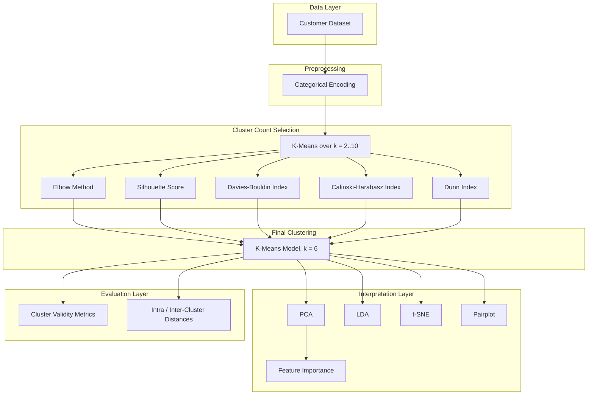

<div align="center">

</div>

---

# K-Means Customer Segmentation

This project demonstrates how unsupervised learning can be combined with rigorous cluster validity analysis to segment customers into meaningful behavioral groups, using K-Means clustering benchmarked across multiple internal validity indices and interpreted through complementary dimensionality reduction techniques.

<div align="left">

[](https://www.python.org/)
[](https://numpy.org/)
[](https://pandas.pydata.org/)
[](https://scikit-learn.org/)
[](https://scipy.org/)
[](https://matplotlib.org/)
[](https://seaborn.pydata.org/)
[](https://www.scikit-yb.org/)
[](https://umap-learn.readthedocs.io/)
[](https://opensource.org/licenses/MIT)

</div>

## Abstract

Customer segmentation is a foundational task in marketing analytics, enabling businesses to tailor strategies to distinct behavioral groups. This project applies K-Means clustering to a customer dataset characterized by demographic and behavioral attributes — gender, age, annual income, and spending score — and addresses one of the central challenges in unsupervised learning: determining and validating the optimal number of clusters. Five complementary internal validity indices, the Elbow Method, Silhouette Score, Davies-Bouldin Index, Calinski-Harabasz Index, and Dunn Index, are computed and compared to select the optimal cluster count. The resulting segments are then interpreted and visualized using three dimensionality reduction techniques, Principal Component Analysis (PCA), Linear Discriminant Analysis (LDA), and t-distributed Stochastic Neighbor Embedding (t-SNE), alongside feature-importance analysis to reveal which customer attributes most strongly characterize each segment.

## Table of Contents

1. [Overview](#overview)
2. [Key Features](#key-features)
3. [Methodology](#methodology)
4. [Cluster Validity Analysis](#cluster-validity-analysis)
5. [Dimensionality Reduction and Visualization](#dimensionality-reduction-and-visualization)
6. [Tools and Technologies](#tools-and-technologies)
7. [Project Structure](#project-structure)
8. [Installation](#installation)
9. [License](#license)
10. [Author](#author)

# Overview

This project performs unsupervised customer segmentation using K-Means clustering on a dataset containing customer gender, age, annual income, and spending score. Rather than selecting an arbitrary number of clusters, the project systematically evaluates the optimal cluster count using five internal validity indices, then interprets the resulting clusters through complementary dimensionality reduction and feature-importance techniques.

Core capabilities include:

* Optimal cluster count selection through multi-metric validation
* K-Means-based unsupervised customer segmentation
* Dimensionality reduction for cluster visualization
* Feature importance and correlation analysis per cluster
* Intra-cluster and inter-cluster distance quantification

---

# Key Features

* K-Means clustering for unsupervised customer segmentation
* Elbow Method with inertia curve and Yellowbrick `KElbowVisualizer`
* Silhouette Score evaluation across candidate cluster counts
* Davies-Bouldin Index for cluster compactness and separation
* Calinski-Harabasz Index for variance-ratio-based validation
* Custom Dunn Index implementation based on inter/intra-cluster distance ratio
* Principal Component Analysis (PCA) with loading and feature-importance analysis
* Linear Discriminant Analysis (LDA) for cluster-aware projection
* t-SNE for nonlinear cluster visualization
* Pairplot-based multivariate feature inspection
* Intra-cluster and inter-cluster distance evaluation

---

# Methodology

The project follows a systematic pipeline that separates cluster-count selection from cluster interpretation, ensuring that the final segmentation is both statistically justified and visually interpretable.



This design allows the optimal number of clusters to be chosen based on convergent evidence from multiple independent validity criteria, rather than relying on a single heuristic.

---

# Cluster Validity Analysis

Selecting the number of clusters is one of the most critical decisions in K-Means clustering. This project computes and compares five complementary internal validity indices across a range of candidate cluster counts (k = 2 to 10):

| Metric | What It Measures |
|:---|:---|
| Elbow Method (Inertia) | Rate of decrease in within-cluster sum of squares as k increases |
| Silhouette Score | How well-separated and cohesive each cluster is |
| Davies-Bouldin Index | Average similarity between each cluster and its most similar counterpart (lower is better) |
| Calinski-Harabasz Index | Ratio of between-cluster to within-cluster dispersion (higher is better) |
| Dunn Index | Ratio of minimum inter-cluster distance to maximum intra-cluster distance (higher is better) |

Based on the convergence of these metrics, the final model is trained with **k = 6** clusters, followed by intra-cluster and inter-cluster distance computation to further quantify cluster compactness and separation.

---

# Dimensionality Reduction and Visualization

Since the clustering is performed in the original 4-dimensional feature space, three complementary dimensionality reduction techniques are used to visualize and interpret the resulting clusters:

* **Principal Component Analysis (PCA):** Projects clusters into 2D space while preserving maximum variance; component loadings and feature-cluster correlations are analyzed to identify the most influential attributes.
* **Linear Discriminant Analysis (LDA):** Projects clusters using the assigned cluster labels as supervision, maximizing between-cluster separability; LDA coefficients are examined to assess feature contribution.
* **t-SNE:** Provides a nonlinear, neighborhood-preserving visualization of cluster structure.
* **Pairplot Analysis:** Visualizes pairwise feature relationships across all clusters to support qualitative interpretation.

---

# Tools and Technologies

| Component | Purpose |
|:---|:---|
| Python | Core implementation |
| Pandas | Data loading and manipulation |
| NumPy | Numerical computation |
| Scikit-learn | K-Means, PCA, LDA, clustering metrics |
| SciPy | Pairwise distance and Dunn Index computation |
| Matplotlib / Seaborn | Data visualization |
| Yellowbrick | Elbow method visualization |
| UMAP-learn | Dimensionality reduction utilities |

---

# Project Structure

```text
K-Means-Customer-Segmentation
│
├── customer_segmentation_kmeans_cluster_validity_analysis.ipynb
│
├── data/
│   └── customers_dataset.csv
│
└── README.md
```

---

# Installation

## Clone Repository

```bash
git clone https://github.com/ParmidaGh/K-Means-Customer-Segmentation.git

cd K-Means-Customer-Segmentation
```

## Create Environment

```bash
conda create -n customer-segmentation python=3.10

conda activate customer-segmentation
```

## Install Dependencies

```bash
pip install pandas numpy scikit-learn scipy matplotlib seaborn yellowbrick umap-learn
```

---

# License

This project is licensed under the MIT License.

---

## Author

**Parmida Ghamari**
M.Sc. Student, University of Tehran
Research Assistant @ Social Networks Lab

**Research Interests:** Machine Learning, Unsupervised Learning & Clustering, Customer Analytics, Dimensionality Reduction, Data Mining

📧 [Parmida.ghamari@gmail.com](mailto:Parmida.ghamari@gmail.com) | 💻 [github.com/ParmidaGh](https://github.com/ParmidaGh) | 💼 [linkedin.com/in/parmida-ghamari](https://www.linkedin.com/in/parmida-ghamari)

---

<p align="center">
Built with Scikit-learn, Pandas, and Yellowbrick
</p>
